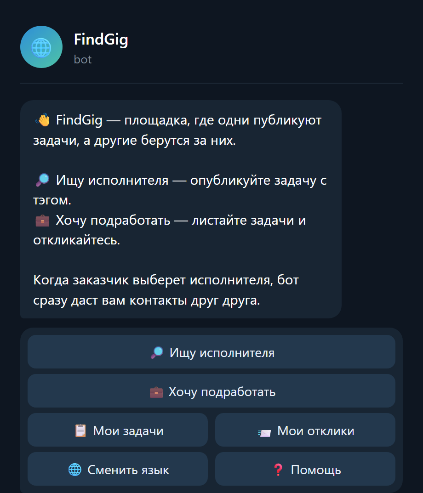
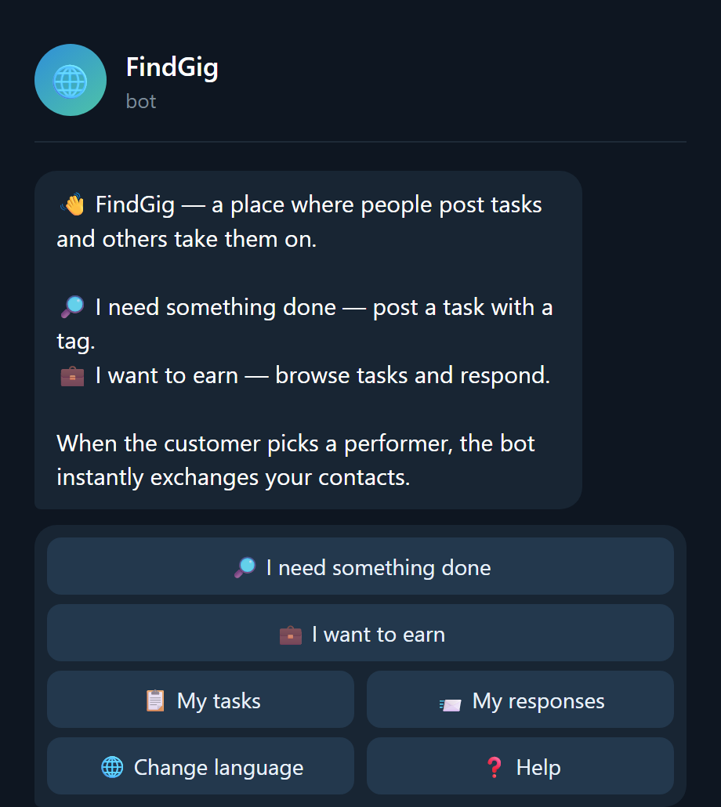
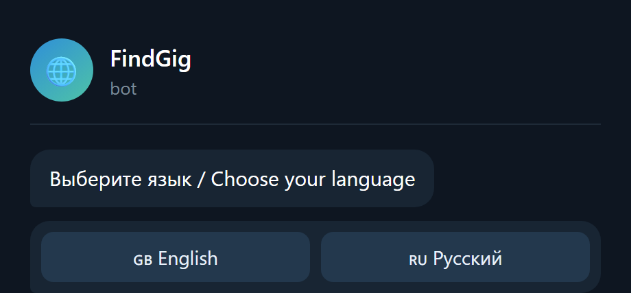
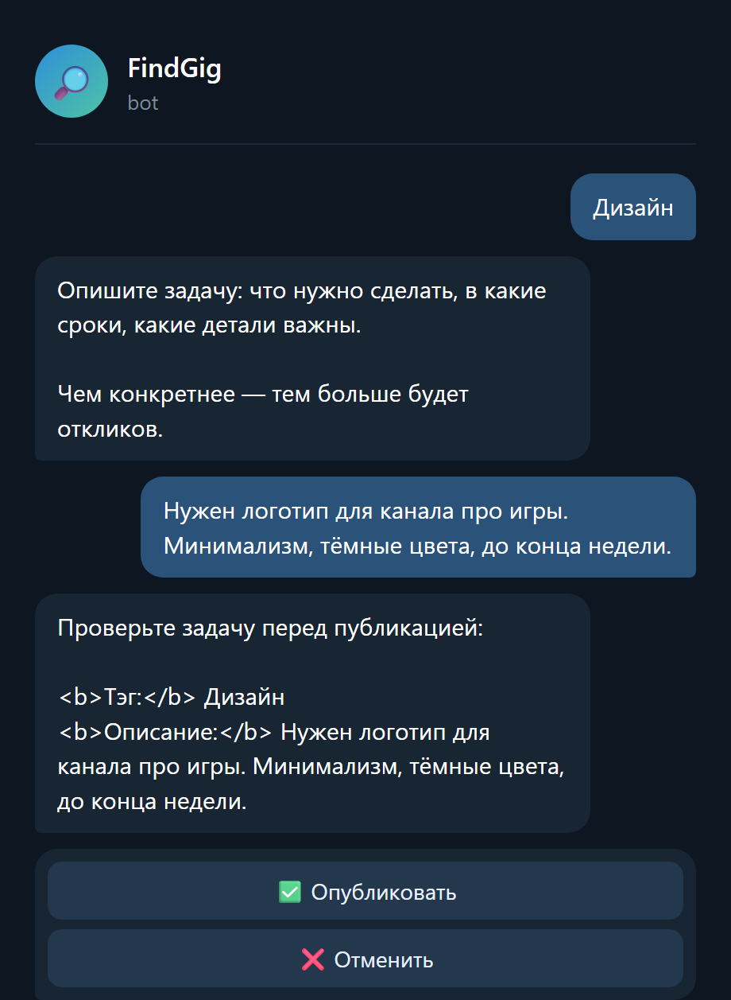
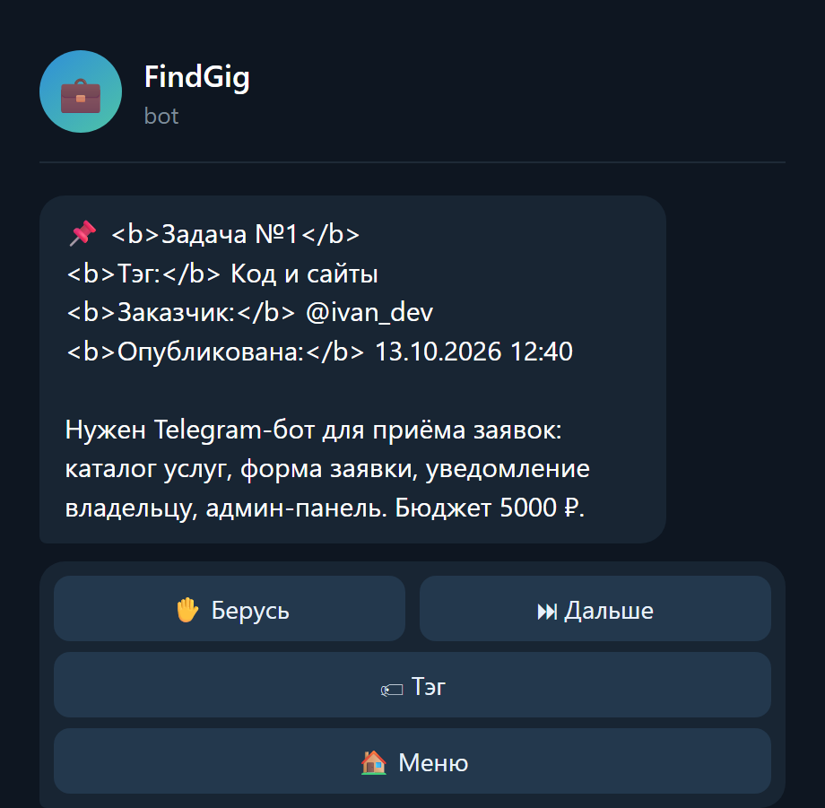
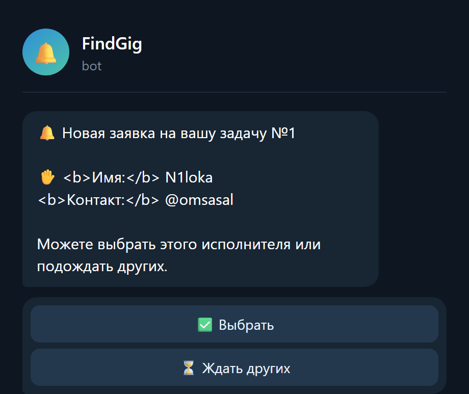
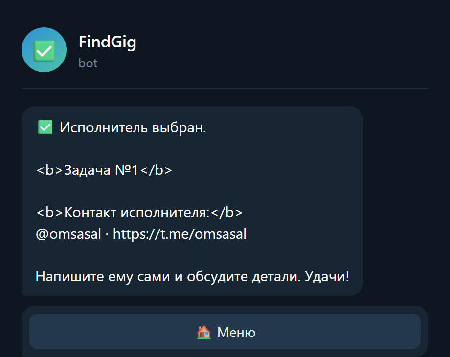
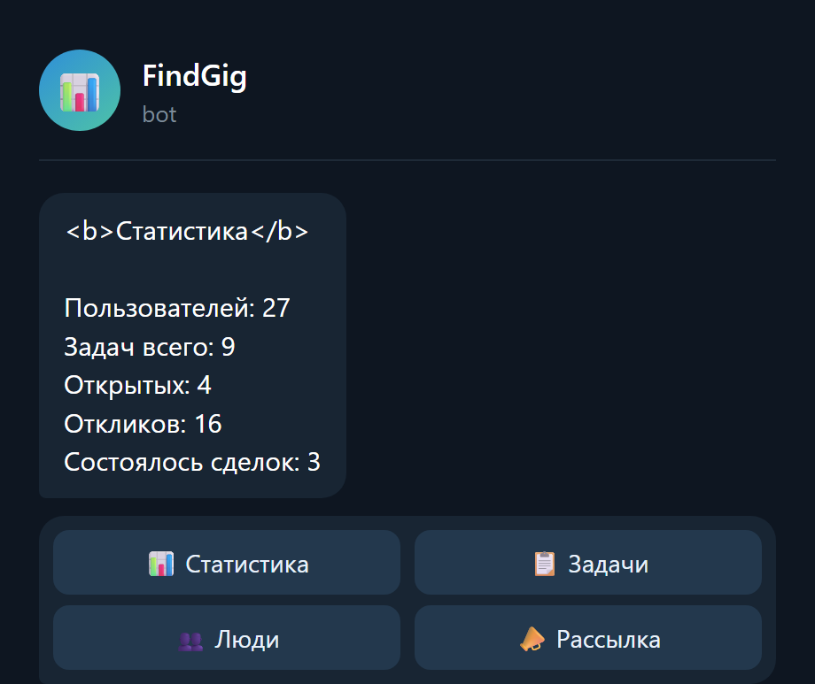

# Шаблон Telegram-бота для приёма заявок

> **Запускаешь бота впервые?** Пошаговая инструкция с точными командами на каждом
> шаге: **[КАК-ЗАПУСТИТЬ.md](КАК-ЗАПУСТИТЬ.md)** — от создания бота у @BotFather
> до проверки первой заявки.

Готовый бот для небольшой компании: каталог услуг с ценами, приём заявок
в пошаговой форме, уведомление владельцу в личку, админ-панель со статистикой,
выгрузкой в Excel и рассылкой.

Сделан так, чтобы **под нового заказчика правился один файл — `config.py`**.
Остальной код трогать не нужно.

Написан на [aiogram 3](https://docs.aiogram.dev/) с базой данных SQLite.

---

## Живой пример: FindGig

Этот репозиторий — **универсальный шаблон**: под нового заказчика правится один
файл `config.py`, а код остаётся. Чтобы было видно, как такой бот выглядит
в реальной работе, вот бот, собранный на том же стеке:

**[@myN1lOKa_zayavki_bot](https://t.me/myN1lOKa_zayavki_bot)** — «FindGig»,
двусторонняя площадка задач с мэтчингом и двумя языками.
Код открыт: **[n1lokaDeep/findgig](https://github.com/n1lokaDeep/findgig)**.

FindGig — не шаблон, а готовый продукт под задачу «заказчик ↔ исполнитель»:
там две роли, лента задач, отклики и обмен контактами. Этот же репозиторий —
основа попроще, для типового заказа «бот принимает заявки».

**Главное меню и выбор языка**

| Русский | English |
| --- | --- |
|  |  |

Язык человек выбирает сам при первом запуске — тексты, кнопки и уведомления
приходят каждому на его языке:



**Публикация задачи заказчиком** — выбор тэга, описание, подтверждение:



**Лента исполнителя** — чужие задачи с откликом и пропуском:



**Мэтчинг** — заказчику приходит уведомление на каждого откликнувшегося:



Заказчик выбирает одного — и обе стороны сразу получают контакты друг друга:



**Админ-панель:**



> Скриншоты собраны скриптом из **настоящих текстов** `i18n.py` и **настоящих
> клавиатур** `keyboards.py` проекта FindGig — на картинках нет ни одной
> выдуманной строки.

---

## Что умеет

**Для клиента заказчика**

- `/start` — приветствие и меню
- Каталог услуг: название, цена, подробное описание
- Заявка в 3 шага: имя → контакт → комментарий → подтверждение
- Проверка ввода: пустое имя или контакт не пропустит
- Кнопка отмены и команда `/cancel`

**Для владельца**

- Каждая новая заявка сразу приходит в личные сообщения Telegram
- `/admin` — панель управления:
  - новые заявки и последние 10
  - отметка «обработана» прямо из сообщения
  - статистика: сколько людей и заявок
  - выгрузка всех заявок файлом CSV для Excel
  - рассылка по всем, кто запускал бота

---

## Быстрый старт

```bash
# 1. Зависимости
python -m venv .venv
.venv\Scripts\activate          # Windows
# source .venv/bin/activate     # Linux и macOS
pip install -r requirements.txt

# 2. Настройки
copy .env.example .env          # Windows
# cp .env.example .env          # Linux и macOS
```

Теперь откройте `.env` и заполните:

| Переменная | Что это |
| --- | --- |
| `BOT_TOKEN` | токен от [@BotFather](https://t.me/BotFather) |
| `ADMIN_IDS` | ваш ID, чтобы получать заявки. Узнать: [@userinfobot](https://t.me/userinfobot) |

```bash
# 3. Проверка, что всё установилось правильно (токен не нужен)
python selftest.py

# 4. Запуск
python bot.py
```

Если в консоли появилось `Бот запущен` — откройте своего бота в Telegram
и отправьте `/start`.

---

## Если Telegram API недоступен

В России `api.telegram.org` блокируется на уровне TCP. Это выглядит коварно:
**пинг до адреса проходит, а соединение не устанавливается**, поэтому бот
запускается без ошибок и просто молчит.

Проверить одной командой:

```bash
curl -s -o NUL -w "%{http_code}" --max-time 15 https://api.telegram.org
```

- `200`, `302` или `401` — API доступен, прокси не нужен.
- `000` — соединения нет. Пропишите `PROXY_URL` в `.env`:

```
PROXY_URL=socks5://127.0.0.1:1080
```

Годится любой HTTP- или SOCKS5-прокси, поднятый локально вместе с VPN.

Для постоянной работы бота лучший вариант — **сервер за пределами России**:
там ничего блокировать не нужно, и бот живёт круглосуточно без вашего
включённого компьютера и без VPN.

---

## Проверка перед сдачей заказчику

```bash
python selftest.py          # база данных и настройки, токен не нужен
python tests/test_flow.py   # весь сценарий бота целиком, токен не нужен
```

Первый скрипт проверяет сохранение заявок и выгрузку. Второй прогоняет
настоящие обработчики через подменённый сетевой слой: `/start`, каталог,
заявку в три шага, уведомление администратора, админ-панель, отмену
и защиту админки от посторонних — 34 проверки. Запускайте перед сдачей,
чтобы не ловить ошибки на живом боте у клиента.

---

## Как адаптировать под заказчика

Всё меняется в `config.py`. Это занимает минут десять.

1. **Название и тексты** — переменные `COMPANY_NAME`, `TAGLINE`, `GREETING`,
   `ABOUT`, `CONTACTS`.
2. **Услуги** — список `SERVICES`. Каждая услуга описывается четырьмя полями:

   ```python
   Service(
       key="basic",                    # служебный код, латиницей
       title="Базовая услуга",          # как называется в списке
       price="от 1 000 ₽",             # как показывать цену
       details="Что входит в услугу…",  # текст в карточке
   )
   ```

   Добавляйте и удаляйте элементы — кнопки в боте построятся сами.
3. **Вопросы формы заявки** — `ASK_NAME`, `ASK_CONTACT`, `ASK_COMMENT`.
4. **Администраторы** — `ADMIN_IDS` в `.env`, через запятую, если их несколько.

---

## Структура

```
telegram-bot-template/
├── bot.py              точка входа, сборка и запуск
├── config.py           ВСЁ, что меняется под заказчика
├── database.py         SQLite: пользователи, заявки, статистика, CSV
├── keyboards.py        кнопки, строятся из списка услуг
├── handlers_user.py    меню, каталог, форма заявки
├── handlers_admin.py   админ-панель, рассылка
├── selftest.py         проверка установки без токена
├── tests/
│   └── test_flow.py    сквозной прогон сценария без токена
├── requirements.txt
└── .env.example
```

---

## Где это может работать круглосуточно

Бот должен быть запущен постоянно — если закрыть консоль, он перестанет
отвечать. Варианты:

- **Компьютер заказчика** — бесплатно, но бот живёт, пока компьютер включён.
- **VPS** — виртуальный сервер, оплата помесячно. Самый предсказуемый вариант
  для клиента, который ждёт работающий сервис.
- **Бесплатные хостинги** — существуют, но обычно засыпают без нагрузки
  или недоступны из России. Прежде чем обещать клиенту, проверьте конкретный
  хостинг своими руками.

Готовое руководство по VPS с командой установки в одну строку:
**[deploy/README.md](deploy/README.md)**. Скрипт `deploy/setup.sh` ставит всё
сам, включая службу systemd, которая поднимает бота после перезагрузки
и после падений.

> **Важно для России:** `api.telegram.org` блокируется на уровне TCP. Русский
> VPS не подойдёт — бот запустится и будет молчать. Нужна локация вне России
> либо прокси. Подробности в [deploy/README.md](deploy/README.md).

Практичный подход для первых заказов: запускать на своём компьютере и честно
предупредить клиента о простое, а на VPS переходить, когда заказы пойдут.

---

## Что можно добавить под конкретный заказ

- Приём оплаты
- Запись на время со свободными слотами
- Уведомления клиенту о смене статуса заявки
- Разделение заявок по нескольким сотрудникам
- Интеграция с Google Таблицами

## Лицензия

MIT — используйте свободно, в том числе в коммерческих заказах.